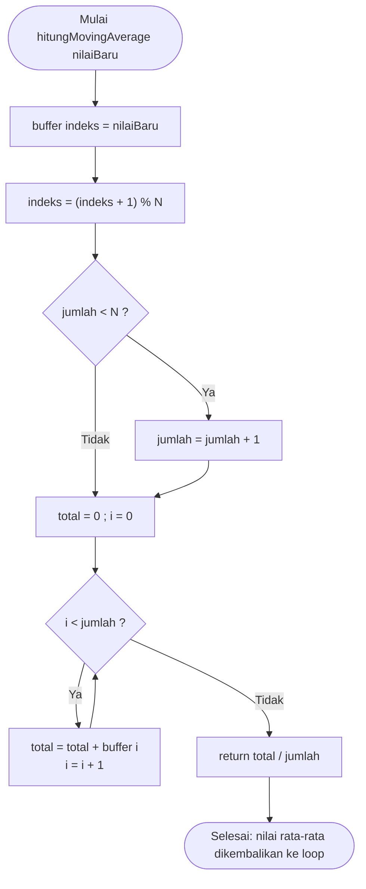

Nama: Wendy Virtus  
NIM: H1H024048  
Shift Awal: C  
Shift Akhir: C  

---

# Pertanyaan Praktikum - Percobaan 5A
## 1. Gambarkan diagram alur (flowchart) proses perhitungan moving average pada fungsi hitungMovingAverage()!



> Catatan: jika ingin memakai gambar flowchart seperti pada Gambar 6 buku catatan, ganti blok di atas dengan tag `` hasil upload.

---

## 2. Jelaskan fungsi dari operasi (indeks + 1) % N pada program tersebut!
Operasi ini membuat indeks buffer bergerak secara melingkar (circular buffer). Setiap data baru ditulis pada buffer[indeks], lalu indeks bertambah satu. Operasi modulo % N mengembalikan indeks ke 0 ketika nilainya mencapai N, sehingga indeks selalu berada pada rentang 0 sampai N−1 dan tidak melewati batas array. Dengan cara ini, setelah buffer penuh, data baru otomatis menimpa data yang paling lama sehingga buffer selalu berisi N pembacaan terakhir tanpa perlu menggeser seluruh isi array.

---

## 3. Apa dampaknya terhadap data hasil filter apabila nilai N diperbesar menjadi 20 atau diperkecil menjadi 2?
Jika N diperbesar menjadi 20, rata-rata dihitung dari lebih banyak data sehingga hasil filter lebih halus dan kebal terhadap derau sesaat, tetapi responsnya lebih lambat: perubahan suhu yang nyata baru terlihat penuh setelah sekitar 20 pembacaan (±40 detik pada interval 2 detik), dan memori buffer yang dipakai lebih besar. Jika N diperkecil menjadi 2, hasil filter cepat mengikuti perubahan suhu tetapi kurang halus sehingga derau masih terlihat dan hasilnya mendekati data mentah. Jadi ukuran N adalah kompromi antara kehalusan data dan kecepatan respons.

---

## 4. Modifikasi program agar ESP32 juga menghitung simpangan baku dari data pada buffer, dan berikan penjelasan di setiap baris kode yang ditambahkan dalam bentuk README.md
```cpp
// =====================================================
// Modul 5 - Percobaan 5A (Modifikasi)
// Moving Average (N = 5) + Min/Max + Simpangan Baku
// =====================================================

#include <DHT.h>

#define DHTPIN 4
#define DHTTYPE DHT22
DHT dht(DHTPIN, DHTTYPE);

const int N = 5;
float buffer[N];
int indeks = 0;
int jumlah = 0;
float suhuMin = 1000.0;
float suhuMax = -1000.0;

float hitungMovingAverage(float nilaiBaru) {
  buffer[indeks] = nilaiBaru;
  indeks = (indeks + 1) % N;
  if (jumlah < N) jumlah++;
  float total = 0;
  for (int i = 0; i < jumlah; i++) {
    total += buffer[i];
  }
  return total / jumlah;
}

// [BARU] Fungsi menghitung simpangan baku (sampel) dari isi buffer
float hitungSimpanganBaku(float rataRata) {
  if (jumlah < 2) return 0.0;                  // [BARU] simpangan baku tidak bisa dihitung dengan <2 data, hindari bagi nol
  float jumlahKuadrat = 0;                     // [BARU] penampung total kuadrat selisih
  for (int i = 0; i < jumlah; i++) {           // [BARU] ulangi untuk setiap data yang sudah terisi di buffer
    float selisih = buffer[i] - rataRata;      // [BARU] selisih data terhadap rata-rata
    jumlahKuadrat += selisih * selisih;        // [BARU] kuadratkan lalu jumlahkan
  }
  return sqrt(jumlahKuadrat / (jumlah - 1));   // [BARU] akar dari (total kuadrat / (n-1))
}

void setup() {
  Serial.begin(115200);
  dht.begin();
}

void loop() {
  float suhu = dht.readTemperature();
  if (isnan(suhu)) {
    Serial.println("Pembacaan gagal, data diabaikan");
  } else {
    float suhuFilter = hitungMovingAverage(suhu);
    float simpangan = hitungSimpanganBaku(suhuFilter);  // [BARU] hitung simpangan baku, memakai rata-rata hasil filter
    if (suhu < suhuMin) suhuMin = suhu;
    if (suhu > suhuMax) suhuMax = suhu;

    Serial.print("Mentah: ");
    Serial.print(suhu);
    Serial.print(" | Filter: ");
    Serial.print(suhuFilter);
    Serial.print(" | StdDev: ");               // [BARU] label simpangan baku
    Serial.print(simpangan);                   // [BARU] tampilkan nilai simpangan baku
    Serial.print(" | Min: ");
    Serial.print(suhuMin);
    Serial.print(" | Max: ");
    Serial.println(suhuMax);
  }
  delay(2000);
}
```

**Penjelasan baris yang ditambahkan (bertanda [BARU]):**
- `hitungSimpanganBaku(float rataRata)`: fungsi yang menerima rata-rata buffer (hasil `hitungMovingAverage()`) agar rata-rata tidak dihitung ulang.
- `if (jumlah < 2) return 0.0;`: simpangan baku sampel membagi dengan `jumlah - 1`, sehingga untuk satu data hasilnya didefinisikan 0 untuk menghindari pembagian dengan nol.
- `selisih = buffer[i] - rataRata` dan `jumlahKuadrat += selisih * selisih`: menghitung kuadrat selisih tiap data terhadap rata-rata lalu menjumlahkannya.
- `sqrt(jumlahKuadrat / (jumlah - 1))`: membagi dengan `jumlah - 1` (varians sampel, sama dengan default `std()` pada pandas) lalu mengakarkannya menjadi simpangan baku.
- `hitungSimpanganBaku(suhuFilter)` pada `loop()`: memanggil fungsi untuk isi buffer terkini.
- `Serial.print(" | StdDev: ")` dan `Serial.print(simpangan)`: menampilkan label dan nilai simpangan baku pada Serial Monitor.

---

# Pertanyaan Praktikum - Percobaan 5B
## 1. Jelaskan fungsi dari blok try-except pada fungsi on_message() dan apa yang terjadi apabila blok tersebut dihilangkan!
Blok try-except melindungi program dari data yang tidak valid. Pada `try`, payload di-parse dengan `json.loads()` dan nilai "suhu" diubah menjadi float. Jika payload bukan JSON yang valid atau bukan angka, terjadi `ValueError`; jika key "suhu" tidak ada, terjadi `KeyError`. Keduanya ditangkap oleh `except`, program mencetak "Data tidak valid, diabaikan" lalu keluar dari fungsi dengan `return` sehingga data rusak tidak masuk ke list `data`. Bila blok ini dihilangkan, kesalahan tersebut menjadi exception yang tidak tertangani pada callback sehingga program dapat berhenti mendadak. Akibatnya akuisisi terhenti, data yang sudah terkumpul tidak tersimpan ke CSV karena tahap 2 tidak pernah dijalankan, dan analisis gagal.

---

## 2. Jelaskan arti nilai z-score dan mengapa batas |z| > 2 digunakan sebagai penentu anomali!
Z-score menyatakan seberapa jauh suatu data menyimpang dari rata-rata dalam satuan simpangan baku, dengan rumus z = (x − rata-rata) / simpangan baku. Nilai z = 0 berarti data tepat di rata-rata, z positif berarti di atas rata-rata, dan z negatif berarti di bawahnya. Pada data yang berdistribusi mendekati normal, sekitar 95% data berada dalam rentang ±2 simpangan baku dari rata-rata, sehingga data dengan |z| > 2 tergolong jarang (sekitar 5%) dan patut dicurigai sebagai anomali. Batas 2 adalah kesepakatan praktis yang sederhana: tidak terlalu ketat sehingga data normal banyak ditandai anomali, dan tidak terlalu longgar sehingga penyimpangan nyata terlewat. Batas ini dapat disesuaikan, misalnya 3 untuk deteksi yang lebih ketat.

---

## 3. Apa kelemahan metode z-score apabila data memiliki tren naik atau turun yang tajam?
Z-score memakai rata-rata dan simpangan baku dari seluruh data, sehingga mengasumsikan data berfluktuasi di sekitar satu nilai tengah yang tetap. Jika data memiliki tren naik atau turun yang tajam, simpangan baku menjadi besar karena memuat perubahan tren, sedangkan nilai di awal atau akhir tren berada jauh dari rata-rata keseluruhan. Akibatnya, data yang sebenarnya wajar (bagian dari tren) dapat ditandai sebagai anomali, sementara lonjakan nyata di tengah tren dapat tidak terdeteksi. Kelemahan lain: rata-rata dan simpangan baku sendiri terpengaruh oleh anomali, metode ini mengasumsikan distribusi mendekati normal, dan pada data yang hampir konstan seperti hasil percobaan ini simpangan baku yang sangat kecil membuat selisih 0,1 °C pun terdeteksi anomali. Solusinya antara lain memakai z-score pada jendela bergerak (rolling) atau menghilangkan tren terlebih dahulu.

---

## 4. Modifikasi program agar menggunakan metode moving average (jendela 5 data) pada data hasil CSV sebelum dihitung z-score-nya, kemudian bandingkan jumlah anomali yang terdeteksi, dan berikan penjelasan di setiap baris kode yang ditambahkan dalam bentuk README.md
```python
# =====================================================
# Modul 5 - Percobaan 5B (Modifikasi)
# Moving average (jendela 5) pada data CSV sebelum z-score,
# lalu membandingkan jumlah anomali
# =====================================================
import pandas as pd
import matplotlib.pyplot as plt

JENDELA = 5   # [BARU] ukuran jendela moving average
BATAS_Z = 2   # [BARU] batas |z| untuk anomali

df = pd.read_csv("data_suhu.csv")  # [BARU] baca data hasil Tahap 2 (bukan dari MQTT lagi)

def hitung_zscore(seri):           # [BARU] fungsi z-score agar bisa dipakai dua kali
    rata2 = seri.mean()
    std = seri.std()
    if std == 0:                   # hindari pembagian dengan nol
        return pd.Series(0.0, index=seri.index)
    return (seri - rata2) / std

# --- Metode A: z-score pada data mentah (cara awal) ---
df["z_mentah"] = hitung_zscore(df["suhu"])             # [BARU]
df["anomali_mentah"] = df["z_mentah"].abs() > BATAS_Z  # [BARU]

# --- Metode B: moving average dulu, baru z-score ---
df["suhu_ma"] = df["suhu"].rolling(window=JENDELA, min_periods=1).mean()  # [BARU] rata-rata 5 data terakhir
df["z_ma"] = hitung_zscore(df["suhu_ma"])              # [BARU] z-score dari data hasil filter
df["anomali_ma"] = df["z_ma"].abs() > BATAS_Z          # [BARU]

# --- Perbandingan ---
print(f"Jumlah data : {len(df)}")                                  # [BARU]
print(f"Anomali data mentah : {df['anomali_mentah'].sum()}")       # [BARU]
print(f"Anomali setelah MA ({JENDELA}) : {df['anomali_ma'].sum()}")  # [BARU]
print(f"Std data mentah : {df['suhu'].std():.4f}")                 # [BARU]
print(f"Std data setelah MA : {df['suhu_ma'].std():.4f}")          # [BARU]

df.to_csv("data_suhu_ma.csv", index=False)       # [BARU] simpan hasil lengkap
print("Hasil tersimpan di data_suhu_ma.csv")     # [BARU]

# --- Visualisasi perbandingan ---
fig, ax = plt.subplots(2, 1, figsize=(10, 7), sharex=True)  # [BARU] dua grafik atas-bawah

ax[0].plot(df.index, df["suhu"], marker="o", label="Suhu mentah")
a1 = df[df["anomali_mentah"]]
ax[0].scatter(a1.index, a1["suhu"], color="red", s=100, label="Anomali", zorder=3)
ax[0].axhline(df["suhu"].mean(), color="gray", linestyle="--", label="Rata-rata")
ax[0].set_title("Z-score pada data mentah")
ax[0].set_ylabel("Suhu (°C)")
ax[0].legend()

ax[1].plot(df.index, df["suhu_ma"], marker="o", color="green", label=f"Suhu MA ({JENDELA})")
a2 = df[df["anomali_ma"]]
ax[1].scatter(a2.index, a2["suhu_ma"], color="red", s=100, label="Anomali", zorder=3)
ax[1].axhline(df["suhu_ma"].mean(), color="gray", linestyle="--", label="Rata-rata")
ax[1].set_title(f"Z-score setelah moving average (jendela {JENDELA})")
ax[1].set_xlabel("Urutan data")
ax[1].set_ylabel("Suhu (°C)")
ax[1].legend()

plt.tight_layout()
plt.savefig("grafik_perbandingan.png")  # [BARU]
plt.show()
```

**Penjelasan baris yang ditambahkan (bertanda [BARU]):**
- `pd.read_csv("data_suhu.csv")`: membaca kembali data hasil akuisisi dari file CSV sesuai soal (data dibaca dari CSV, bukan dari memori).
- `JENDELA = 5` dan `rolling(window=JENDELA, min_periods=1).mean()`: menghitung rata-rata bergerak 5 data pada kolom baru `suhu_ma`; `min_periods=1` membuat empat data pertama tetap dihitung dari data yang tersedia.
- `hitung_zscore(seri)`: fungsi yang menghitung z-score untuk kolom tertentu agar rumus yang sama dipakai pada data mentah dan data moving average; jika simpangan baku 0, z-score diisi 0.
- `df["anomali_mentah"]` dan `df["anomali_ma"]`: penanda anomali (|z| > 2) untuk masing-masing data, sehingga jumlah anomali keduanya dapat dibandingkan.
- `print(... .sum())`: menampilkan jumlah anomali data mentah dan data moving average (pada percobaan ini turun dari 3 menjadi 0).
- `plt.plot(df.index, df["suhu_ma"], ...)`: menambahkan garis moving average pada grafik agar terlihat perbedaannya dengan data mentah.

---

# Pertanyaan Analisis
## 1. Uraikan hasil tugas pada praktikum yang telah dilakukan pada setiap percobaan!
Pada Percobaan 5A, ESP32 membaca suhu dari mock function setiap 2 detik, menghitung moving average dari 5 pembacaan terakhir, serta mencatat suhu minimum dan maksimum. Serial Monitor menampilkan data mentah, hasil filter, minimum, dan maksimum; suhu mentah turun dari 29,5 menjadi 29,3 °C dan hasil filter mengikutinya secara lebih halus dengan sedikit keterlambatan. Pada tugas tambahan, program dikembangkan untuk menghitung simpangan baku isi buffer. Pada Percobaan 5B, program Python menerima data suhu dari broker MQTT, menyimpannya ke data_suhu.csv beserta waktu penerimaan, menghitung statistik, mendeteksi anomali dengan z-score (3 anomali pada 20 data yang dicatat), dan menghasilkan grafik dengan penanda anomali. Pada tugas tambahan, moving average 5 data diterapkan sebelum z-score dan jumlah anomali turun dari 3 menjadi 0.

---

## 2. Bandingkan pengolahan data di sisi perangkat (Percobaan 5A) dengan pengolahan data di sisi komputer (Percobaan 5B) dari segi kecepatan, kompleksitas analisis, dan kebutuhan sumber daya!

| Aspek | Sisi perangkat (5A, ESP32) | Sisi komputer (5B, Python) |
|---|---|---|
| Kecepatan | Hasil tersedia seketika setiap pembacaan (2 detik) tanpa menunggu jaringan; respons cepat. | Bergantung pada pengiriman via WiFi/broker dan baru menganalisis setelah 30 data terkumpul (±2,5 menit); lebih lambat. |
| Kompleksitas analisis | Sederhana: moving average, min/max, simpangan baku; dibatasi memori dan daya komputasi. | Lebih kompleks: statistik deskriptif, z-score, deteksi anomali, dan visualisasi dengan pustaka siap pakai. |
| Sumber daya | Hemat: memori kecil (buffer 5 data), tetapi membebani CPU dan memori mikrokontroler yang terbatas. | Besar: butuh komputer, Python, dan pustaka; memori dan penyimpanan (CSV) hampir tak terbatas untuk data historis. |
| Data yang dikirim | Dapat dikurangi karena data sudah diringkas/difilter sebelum dikirim. | Menerima seluruh data mentah sehingga lalu lintas data lebih besar. |

Kedua pendekatan saling melengkapi: pengolahan ringan di edge untuk respons cepat dan penghematan data, sedangkan analisis yang lebih kompleks dan penyimpanan data historis dilakukan di sisi komputer atau cloud.

---

## 3. Bagaimana pengaruh pemilihan ukuran jendela moving average terhadap kualitas data dan kecepatan respons sistem kendali apabila data tersebut digunakan untuk mengendalikan aktuator?
Jendela yang besar menghasilkan data lebih halus sehingga aktuator tidak mudah menyala-mati akibat derau sesaat (misalnya kipas yang berkedip di sekitar ambang suhu). Namun, hasil filter tertinggal terhadap perubahan sebenarnya (pada Percobaan 5A, hasil filter baru mendekati data mentah setelah beberapa pembacaan), sehingga aktuator terlambat merespons ketika suhu benar-benar naik. Sebaliknya, jendela yang kecil membuat respons aktuator cepat tetapi data kurang halus dan lebih rentan terhadap derau serta pemicu palsu. Ukuran jendela perlu dipilih sesuai kebutuhan: untuk proses yang lambat berubah seperti suhu ruangan, jendela lebih besar dapat dipakai, sedangkan untuk kondisi yang menuntut respons cepat dipilih jendela yang lebih kecil.

---

## 4. Bagaimana hasil analisis dan deteksi anomali dapat dimanfaatkan untuk meningkatkan keandalan sistem IoT, misalnya pada sistem smart farming atau smart home?
Deteksi anomali membantu memisahkan data yang wajar dari data yang janggal sebelum dipakai untuk mengambil keputusan. Pada smart farming, pembacaan kelembapan tanah yang tiba-tiba melonjak atau jatuh dapat ditandai sebagai anomali sehingga pompa penyiram tidak menyala hanya karena sensor error, dan lonjakan yang berulang dapat memicu pemberitahuan bahwa sensor perlu diperiksa. Pada smart home, lonjakan suhu yang tidak wajar dapat dikenali sebagai gejala awal masalah (misalnya kebakaran atau AC rusak) dan memicu alarm atau notifikasi lebih cepat. Data yang telah difilter dan diverifikasi juga membuat kendali aktuator lebih stabil, mengurangi alarm palsu, dan data historis di CSV dapat dianalisis untuk perawatan sensor secara prediktif, sehingga keandalan sistem meningkat.
